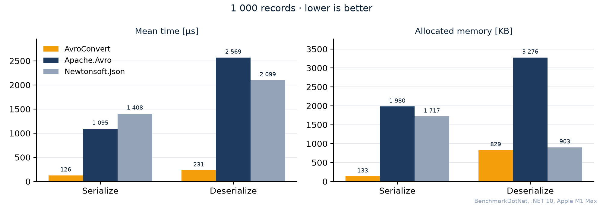

Rapid Apache Avro serializer for .NET

[](https://github.com/AdrianStrugala/AvroConvert)
[](https://soltechnology.dev/avroconvert/online/)
[](https://github.com/AdrianStrugala/AvroConvert/blob/master/LICENSE.md)

## Docs

[AvroConvert documentation](https://github.com/AdrianStrugala/AvroConvert/tree/master/docs)

[Apache Avro specification](http://avro.apache.org/)

[First steps with Avro in .NET](https://www.c-sharpcorner.com/article/how-to-work-with-avro-data-type-in-net-environment/)


## Why AvroConvert

**Avro combines the self-describing schema of JSON with the size and speed of binary serialization.** AvroConvert brings it to .NET the way you already serialize JSON: plain C# objects in, `byte[]` out – no code generation, no `.avsc` files.

|                                                                          |                       AvroConvert                       |         Apache.Avro          | Newtonsoft.Json |
|--------------------------------------------------------------------------|:-------------------------------------------------------:|:----------------------------:|:---------------:|
| Works on plain C# classes – no generated code or schema files            |                           ✔️                            |              ❌              |       ✔️        |
| Native .NET types (`Dictionary`, `List`, `DateTime`, `Guid`, `decimal`…) |                           ✔️                            |              ❌              |       ✔️        |
| Compact binary payload                                                   |                           ✔️                            |              ✔️              |       ❌        |
| Schema stored with the data – readable, versionable, evolvable           |                           ✔️                            |              ✔️              |       ❌        |
| Compression codecs                                                       | Deflate · Snappy · Zstandard · GZip · Brotli (built-in) | Deflate (others via add-ons) |       ❌        |

What it means for your services:
* **Smaller data** – a 1 000-record payload is 2.9× smaller than JSON before compression, and codecs shrink it further → lower storage and network cost
* **Faster round trips** – less time spent in serialization and on the wire between microservices
* **Safer by default** – binary on the wire is not readable in plain text, and the embedded schema protects against silent shape drift

### Benchmark

1 000 records (`User` with a nested `Contact` and two `Offering`s), serialized to and deserialized from `byte[]`. Apache.Avro with classes generated by `avrogen`:



Memory allocated (serialize + deserialize): AvroConvert 962 KB, Apache.Avro 5 255 KB, Newtonsoft.Json 2 620 KB.

Results for 1 and 20 000 records: [raw results](https://github.com/AdrianStrugala/AvroConvert/blob/master/docs/benchmarks/2026-10-28-libraries-avroconvert-vs-apache-vs-newtonsoft.md) · `benchmarks/LibrariesBenchmark`

## Features

#### Files and APIs
```csharp
byte[] avro = AvroConvert.Serialize(orders, new AvroConvertOptions { Codec = CodecType.Zstandard });   // schema travels with the data
List<Order> read = AvroConvert.Deserialize<List<Order>>(avro);
```

#### Kafka with Confluent Schema Registry
```csharp
var producer = new ProducerBuilder<string, Order>(config)
    .SetAvroValueSerializer(schemaRegistry)                           // plain C# class, no avrogen
    .Build();
```

#### Schema evolution
```csharp
OrderV2 order = AvroConvert.Deserialize<OrderV2>(writtenByV1);      // data from the old version, new class
```

#### Large files
```csharp
await foreach (var order in AvroConvert.Deserialize<Order>(fileStream)) { /* one at a time */ }
```

#### Schema check in CI
```bash
avroconvert compat v1.avsc v2.avsc        # exit code 1 when consumers would break
```

All features with one line of code each: [documentation](https://github.com/AdrianStrugala/AvroConvert/blob/master/docs/Documentation.md#at-a-glance)


## License

AvroConvert is source-available. Noncommercial use and small companies pay nothing; everyone else buys a yearly licence for the whole organisation.

| You are… | Licence | Cost |
|---|---|---|
| Individual, student, non-profit, public institution, research or evaluation | [PolyForm Noncommercial 1.0.0](https://github.com/AdrianStrugala/AvroConvert/blob/master/licenses/PolyForm-Noncommercial-1.0.0.md) | Free |
| Company with fewer than 100 people **and** under 1,000,000 USD annual revenue | [PolyForm Small Business 1.0.0](https://github.com/AdrianStrugala/AvroConvert/blob/master/licenses/PolyForm-Small-Business-1.0.0.md) | Free |
| Any other company or organisation | [Commercial Licence](https://github.com/AdrianStrugala/AvroConvert/blob/master/licenses/Commercial.md) — Business under 1,000 people, Enterprise from 1,000 people, listed companies and public sector | Annual, per organisation, unlimited developers — [buy at soltechnology.dev](https://soltechnology.dev/avroconvert/) |

Say which licence you rely on, in code or through the `AVROCONVERT_LICENSE` environment variable (`NonCommercial`, `SmallBusiness` or the key). It is optional for the free licences and expected for commercial ones; nothing is enforced and nothing phones home.

```csharp
AvroConvert.License = AvroLicense.NonCommercial;          // or AvroLicense.SmallBusiness
AvroConvert.License = AvroLicense.Commercial("AVC1.…");   // licence key received by e-mail after purchase
```

Details in [LICENSE.md](https://github.com/AdrianStrugala/AvroConvert/blob/master/LICENSE.md).

Versions 3.x stay under CC BY-NC-SA 3.0. A commercial licence bought for 4.x also covers the 3.4.x releases, so a team that is not on .NET 10 yet can be licensed now and upgrade later. If you bought a 3.x licence from Xabe, it still covers 3.x, and you can have a free perpetual licence for 4.x and every later version: send the invoice to contact@soltechnology.dev, there is no deadline ([licenses/Commercial.md](https://github.com/AdrianStrugala/AvroConvert/blob/master/licenses/Commercial.md), section 12).

## Contribution

We want to improve AvroConvert as much as possible. If you have any idea, found next possible feature, optimization opportunity or better way for integration, leave a comment or pull request.


Thank you a million [to all the contributors](https://github.com/AdrianStrugala/AvroConvert/graphs/contributors) to the library, including those that raise issues, started conversations, and those who send pull requests. Thank you!


## Related Work  

- [](https://soltechnology.dev/avroconvert/online/) – schema → C# model, Avro file viewer, JSON → Avro, schema compatibility checker, Kafka message decoder; runs in your browser
- [](https://www.nuget.org/packages/SolTechnology.Avro.Http/) – Avro as the wire format between HTTP services: HttpClient, MVC and Minimal API
- [](https://www.nuget.org/packages/SolTechnology.Avro.Kafka/) – Confluent Schema Registry serializers for plain .NET objects, interoperable with Java/Python/Go
- [](https://www.nuget.org/packages/SolTechnology.Avro.Cli/) – `avroconvert` command line tool with the avro-tools commands (induce, compile, tojson, getschema, canonical, fingerprint), compatibility and Schema Registry checks for CI
- [Avro API article](https://www.c-sharpcorner.com/blogs/avro-rest-api-as-the-evolution-of-json-based-communication-between-mic) 

---

Apache Avro, Avro and Apache are trademarks of [The Apache Software Foundation](https://www.apache.org/). AvroConvert is an independent implementation of the Avro specification for .NET and is not affiliated with, endorsed by or sponsored by the ASF.
